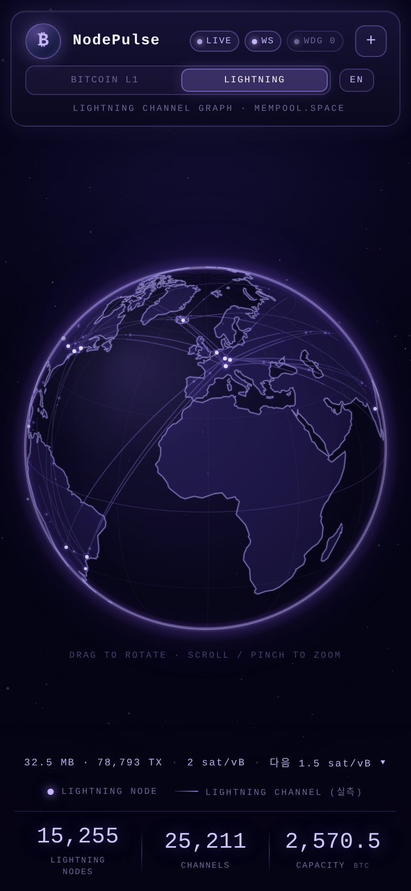
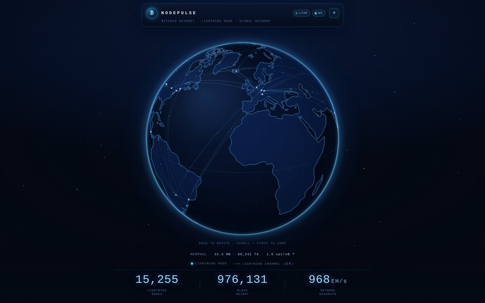

<div align="center">


# NodePulse

**Bitcoin L1 mainnet full-node map and real-time network monitor, with the Lightning channel graph and the public whale / entity table one tap away.**


</div>

NodePulse watches Bitcoin **L1 mainnet** first: the reachable full-node network as the
Bitnodes crawler sees it — node count, clear-net/Tor/I2P split, country and continent spread,
client versions — plus the chain tip, mempool pressure, fee market and the next-block fee
projection. The Lightning channel graph is a second layer, and **ENTITIES / Whale Watch** a
third: 20 publicly named entities over 42 verified addresses, ranked by the bitcoin actually
tracked for them.

It runs with **zero dependencies**: no framework, no bundler, no package manager, no CDN, no
external image or font request; the entire application is a single self-contained document
that draws every frame with the Canvas 2D API.

## Three layers

| Layer | What the globe shows | Primary data |
| --- | --- | --- |
| **Bitcoin L1** (default) | every unique coordinate the Bitnodes crawler geolocated, one dot per 3° cell | `bitnodes.io/api/v1/snapshots/latest/?field=coordinates` |
| **Lightning** | up to 22 nodes sampled from the real channel graph, one arc per open channel between drawn dots | `mempool.space/api/v1/lightning/channels-geo` |
| **Entities** | nothing on the globe: an address has no location, so none is invented. The panel is the layer | the verified entity table, read live per address from `mempool.space/api/address/{address}` |

The switcher sits under the title (`BITCOIN L1 | LIGHTNING | ENTITIES`), and the chosen layer
is remembered. Switching tabs never moves the globe: the HUD height is measured once per
viewport and kept, so the centre and radius are the same in all three.

Each layer carries its own palette, so the globe you are looking at is readable at a glance:
**Bitcoin L1** keeps the original cyan / deep-blue identity (`#38bdf8` on `#040914`), and
**Lightning** has a distinct electric violet one. Neither layer borrows the other's signal
colour.

The L1 layer draws **no links at all**. Bitnodes publishes no per-node peer graph, so the only
honest options are to draw nothing or to invent a mesh — it draws nothing. Tor and I2P nodes
(15,577 of 21,826 in the bundled snapshot) carry no coordinates, so they are counted in the
totals and the transport split but not placed on the globe.

<div align="center">


</div>

<div align="center">

</div>

---

## Core design principle — zero simulated data

Every number and every line on the globe is a value the network actually reported. Nothing
is generated, interpolated from a model, or placed for visual balance.

| Element on screen | Source | Transport |
| --- | --- | --- |
| Block height, latest blocks, block interval | `mempool.space/api/blocks/tip/height`, `/api/v1/blocks` | REST |
| Hashrate, difficulty adjustment | `/api/v1/mining/hashrate/1w`, `/api/v1/difficulty-adjustment` | REST |
| Mempool size, transaction count, fee histogram | `/api/mempool`, `/api/mempool/recent`, `/api/v1/fees/recommended` | REST |
| Lightning node count, channel count, total capacity | `/api/v1/lightning/statistics/latest` | REST |
| Node distribution by country | `/api/v1/lightning/nodes/countries` | REST |
| Globe node positions, aliases, capacities, degrees | `/api/v1/lightning/channels-geo`, `/api/v1/lightning/nodes/{pubkey}`, `nodes/rankings/{connectivity,liquidity}` | REST |
| Inter-node arcs | `channels-geo` — one arc per **real open channel** | REST |
| L1 reachable node count, crawler height | `bitnodes.io/api/v1/snapshots/latest/?field=coordinates` | REST (native bridge on Android) |
| L1 unique node coordinates (the globe dots) | same `?field=coordinates` payload | REST (native bridge on Android) |
| L1 clear-net / Tor / I2P split | `?field=top` → `top_asns` (`TOR`, `I2P`, `AS…`) | REST (native bridge on Android) |
| L1 client versions (`/Satoshi:x.y.z/`) | `?field=top` → `top_user_agents` | REST (native bridge on Android) |
| L1 countries / continents | `bitnodes.io/api/v1/nodes/` (all pages) folded into the bundled snapshot by `fetch_l1.py` | build time |
| Next-block fee projection | `mempool-blocks` stream | WebSocket |
| Mining pool share of the last week | `/api/v1/mining/pools/1w` | REST |
| Live block / mempool / fee pushes | `wss://mempool.space/api/v1/ws`, with `mempool.emzy.de` and `mempool.ninja` as mirror fallbacks | WebSocket |
| Watchdog alerts | derived from the values above: last block age, fee spike, pool share, a hash change at a seen height | local |

* **The arcs are channels, not decoration.** A line is drawn only when both endpoints are
  among the nodes on screen *and* the pair exists as an open channel in `channels-geo`.
  There is no proximity heuristic, no nearest-neighbour fallback, no synthetic mesh.
* **Node selection is topology-driven.** Up to 22 nodes are sampled from the real channel
  graph, not from a ranking list, so every dot is a node that actually holds channels that
  can be drawn (`fetch_channels.py`, `MAX_NODES`).
* **Built-in snapshot, honestly labelled.** A snapshot of the same real payloads is
  embedded at build time (`src/data/seed-nodes.js`, `src/data/channels-data.js`) so the app
  still shows the network's last known geometry with no connection. The UI never passes the
  snapshot off as live: the status pill and the data row report the state, the source, and
  the timestamp of what is being shown.
* **A static answer says it is static, and says why.** The L1 layer is in one of three
  states — a live Bitnodes read, a saved answer, or the bundled build-time snapshot — and
  three places on screen name it: the row under the title (`… · live` / `… · cached` /
  `… · snapshot · CORS`), the panel's *L1 freshness* row, and the globe legend. In a plain
  browser the state is fixed: `bitnodes.io` sends no `Access-Control-Allow-Origin`, so the
  read cannot succeed however good the network is. The page makes one attempt, stops the L1
  poll for the session and prints `static snapshot · browser CORS block` with the note that the Android app reads it live through its native
  bridge — a frozen picture never passes for a live network. The country split is the
  build-time snapshot in every case and is labelled with its capture date wherever it is
  drawn.
* **Rate limits are surfaced, not hidden.** Requests rotate across
  `mempool.space`, `mempool.emzy.de`, and `mempool.ninja`, and the WebSocket rotates through
  the same three mirrors; when all of them fail the app degrades to the snapshot and says so
  instead of substituting values.
* **A saved answer is rebuilt, not trusted.** localStorage is writable by anything that has
  ever run on this origin and `JSON.parse` returns whatever the string held. Every field of
  the saved Lightning sample (key, alias, coordinates, channel count, capacity, sockets, Tor
  flag, peers, tag) and of the saved price snapshot (block height, retarget date, fee rows,
  country rows) is re-typed on the way out of storage, so a poisoned cache costs the app its
  remembered values and never its rendering — a card cannot print `[object Object]` or `NaN`
  from a cache it did not write.
* **A malformed answer is rejected, not drawn.** Every feed shape-checks what it uses — REST
  loaders and WebSocket pushes alike: a finite number where a figure is printed, a list where
  a row list is walked, a hash string where a hash is shortened. A payload that fails keeps
  the previous value on screen, so a broken mirror or a captive portal cannot turn a figure
  into `NaN` or blank the panel, and a failed per-node detail fetch keeps the alias, city and
  country already cached instead of overwriting them with nothing.
* **Country counts say which snapshot they are.** Bitnodes exposes per-node country only
  through a paginated 21,826-row list (~20 MB). The app fetches it at build time
  (`fetch_l1.py`) and stamps that block with the capture date instead of pretending it is
  live; the live number, height, transport split, client versions and globe dots come from
  the two light endpoints above.
* **Nothing the crawler cannot know is invented.** No per-node latency, uptime, disk size or
  per-node height; no guessed P2P connection between L1 nodes.

---

## Architecture and technical highlights

The constraint that shapes the whole codebase is that a phone must hold 60 fps on a
software-rasterised Canvas while the network is still arriving. Each decision below exists
to remove per-frame work.

### 1. 3D orthographic projection with pre-computed ring caches
The globe is an orthographic projection of lon/lat geometry, not a raster or a WebGL
texture. `prepRing()` converts every coastline ring once into unit-sphere vectors; each frame
`projectRing()` applies the camera's pre-computed sin/cos matrix and produces screen-space
points plus a `z` value per point. No trigonometric function is evaluated at draw time, and
the same cache feeds land, graticule, and hit-testing.

### 2. A geometric horizon, and fills that close on the limb
Naive polygon filling of a sphere breaks in two ways: rings that cross the antimeridian
produce chords straight across the disc, and closing a ring along the back of the sphere
inverts the covered area. Here the horizon is solved analytically — the visible hemisphere is
exactly `z = 0` — so a ring is split into visible runs at its own `z = 0` crossings, and
`fillRun()` closes each run along the limb arc between those crossings. `fillRing()` then
batches every run of every continent into **one** path and **one** fill call per frame. The
result is a solid body with no seam, no chord, and no ocean filled at any rotation
(verified pixel-by-pixel by `test/fill-truth.js`, below).

### 3. Real-topology graph pruning that keeps the edge of the network
`channels-geo` returns thousands of channels; drawing them all is noise. The graph is pruned
to `LINK_PER_NODE = 5` arcs per node by processing nodes in ascending real degree, so a
small regional node keeps its one or two channels instead of being crowded out by a hub.
Out of 5 812 usable channels in the current snapshot, the globe draws about 44 arcs between
20 plotted nodes: a single connected component that still keeps low-degree regional nodes
visible, at under 1 % of the raw edge count.

The path from the 1.5 MB payload to those arcs is one pass per stage. A node key is checked
by its 66 code points instead of two regular expressions per row; each node's grid cell,
region and cluster key are computed once at parse time instead of three times per candidate
per round; the pick keeps a running count of how many already-picked nodes each candidate
shares a real channel with, so adding a pick touches only that node's own peers; and the
per-node pair count in the channel cap is measured once instead of inside the sort comparator.
On the captured 7 773-row payload the whole path — parse, pick, cap — measures about 17 ms
(was 36 ms), of which the pick is 4.5 ms (was 23.5 ms), with the picks and the capped links
byte-for-byte identical.

### 4. A 60 fps mobile budget
* **No `shadowBlur`, ever.** Every glow is a pre-rendered radial-gradient sprite blitted
  with `drawImage`; `shadowBlur` alone costs more than the whole rest of the frame on a
  mid-range Android GPU.
* **Baked offscreen layers.** Starfield, globe body, atmosphere rim and land glow are
  rendered once per resize into offscreen canvases; a frame only blits them.
* **Depth-banded strokes.** Channel arcs are projected once, then stroked in 2–3 batched
  depth bands whose alpha follows `smoothstep(z)`, so near arcs read as bright and far arcs
  fade toward the limb — a handful of stroke calls for the entire network.
* **Continuous packet interpolation.** `eachPacket()` places each moving light packet by
  interpolating along its arc with the real timestamp, so motion stays correct even when a
  frame is late; packets are not stepped per frame.
* **Adaptive resolution.** Device pixel ratio is capped at 2, and an adaptive tier drops the
  backing store to 0.75, 0.62, then 0.50 when frames persistently miss vsync, stepping back
  up when they do not.
* **Time-driven animation.** Rotation and pulses are computed from the `requestAnimationFrame`
  timestamp, so the globe's motion is independent of frame loss.
* **Nothing runs behind a hidden page.** The globe's frame loop already stopped on
  `visibilitychange`; every repeating timer now does too — polling, refetching, panel
  repaints and the clock all skip while `document.hidden`, and returning to the page
  repaints the clock, the status and the open panel at once so the resumed screen is never
  a stale one.
* **Batched node drawing.** The two thousand-or-so globe dots are drawn one path and one
  fill/stroke per alpha level instead of per dot, with the limb fade and pulse quantised
  to a few levels; geometry and colours are unchanged and the canvas state changes per
  frame drop from thousands to a few dozen.
* **A slow phone clock never prints a negative age.** Block and cache timestamps come from
  the server, so a device clock a few seconds behind makes `Date.now() - stamp` negative.
  Every elapsed figure is clamped at zero — the block list reads `0s ago` instead of the
  em dash a negative second count used to produce, and the watchdog gap never goes below
  zero.
* **A lost focus drops the gesture.** When the WebView loses focus mid-pinch (the app is
  backgrounded, a call arrives) no `pointerup` follows; `touchcancel`, `blur`, `pagehide`
  and a hidden page now clear the pointers, the pinch base and the unfinished drag, so the
  globe keeps answering taps and never re-scales from a distance it no longer knows.

### 5. Zero-dependency build and an automated verification suite
`build.py` inlines CSS, geometry, snapshots, application code, and the base64 app icon into
one document — about 386 KB — with tokens that fail the build if any substitution is missed,
and it refuses to emit a file that could break out of its own `<script>` block. The
application code is split by responsibility into thirteen files under `src/js/` that share one
function scope (`00-core` … `90-boot`, the last one closing the IIFE); `build.py` joins them
in file-name order into the same single script block, so the split costs nothing at run time,
the policy still names one hash, and the release build still has no second copy of the app to
drift from. `python3 build.py --check` compiles the assembled code with `node --check`.
`35-cluster.js` is the on-demand clustering engine for the ENTITIES / Whale Watch tab: it
reads nothing at boot, and its public surface and display rules are written down in
`docs/cluster-api.md`. `36-entities.js` is the tab itself — the verified seed
(`src/data/entities-data.js`), the per-address live reads, the watchlist, and the clustering
card that keeps `Verified`, `Common-Input` and `Change Est.` apart (§8 of that document)
and prints every total that carries an estimate with its verified part beside it.

### 6. Two published files, and what the app does without them
The build writes two JSON files beside the HTML: `dist/entities.json` and
`dist/l1-snapshot.json`. Publishing them at
`https://corejbh.github.io/nodepulse/{entities,l1-snapshot}.json` is a copy — nothing in the
build uploads anything. The app tries both in the background after its first paint:

* a **newer** table is adopted and cached in `localStorage`, an older one is ignored, and a
  missing or malformed one changes nothing at all;
* the entity table is the verified seed either way, and the L1 panel keeps the copy built
  into the page;
* when the published Bitnodes snapshot is in use, the row under the title reads
  `DAILY SNAPSHOT` instead of `SNAPSHOT`, and the panel names the date and the block — with
  the HUD height and the globe's centre untouched, because that height is reserved once per
  viewport rather than re-measured on a label change.

| Harness | What it proves | Result |
| --- | --- | --- |
| `test/headless.js` | Builds `dist/nodepulse.html` and the `--test` build, then a DOM + rendering contract against stubbed canvas with real recorded payloads: all three layers, the entity seed and its ranking (the Patoshi estimate added to the held total with its verified part printed beside it, the block-1 P2PK correction), the five filter chips, the watchlist and its live read, `ANALYZE CLUSTER` with progress and `CANCEL` and the §8 display rules, the zoom ceiling and the zoom-scaled drag, the 24 px touch target, a globe that does not move when a tab changes, the daily Bitnodes snapshot (adopted, older ignored, malformed refused), both layers, bridge (single-piece and chunked delivery, a lost chunk, the timeout floor against the native one, one bridge attempt after three failed mirrors), snapshots, the browser-only Bitnodes stop, a cached answer kept out of LIVE, mempool-blocks, all four watchdog alerts, mirror fallback, malformed REST and WebSocket payloads (including a string count in the country, transport-split and version rows), a failed node-detail fetch, a clock running behind the API, a pinch dropped by a lost focus, a five-second frame's inertia, a held reconnect behind a hidden page, an offline phone that asks no host, the English-only source and build, a cache poisoned field by field (a string channel count, an object capacity, a string Tor flag, an object alias, a number in the peers list, a junk retarget date), the CORS-blocked browser's static-snapshot labelling, the shell back call closing the card and then the panel, and an 800×450 landscape layout | **495 / 495 assertions pass** |
| `HttpBridgePolicyTest.java` | The bridge's policy on the JVM: the request-id shape, the four-host allowlist (scheme, credentials, port, lookalike names), a redirect to another host or to plain http refused while a hop inside the allowlist is followed, loopback/link-local/private/CGNAT/multicast/unspecified/IPv6-unique-local addresses refused, and the navigation policy two `shouldOverrideUrlLoading` overloads answer | `:app:testDebugUnitTest`, 10 tests |
| `HttpBridgeChunkTest.java` | The 32 K chunk boundaries `HttpBridge` hands a body over with, walked at limits 1–9 over emoji and flag text: no chunk ends in a lone high surrogate or starts with a lone low one, and the parts join back into the body | `:app:testDebugUnitTest`, 7 tests |
| `test/cluster.js` | The on-demand clustering engine, loaded exactly as `build.py` joins it (`00-core.js` + `35-cluster.js` in one `vm` scope) with `fetch` and `localStorage` stubbed: common-input merging and its direction (a payment the entity received never adopts the payer), change estimation and its refusals (two plausible outputs, two round outputs, mixed script types, three outputs), coinjoin exclusion by equal outputs and by fan-in/fan-out, the per-address and total call caps, cancel through `cancelCluster()` and through a caller's `AbortSignal`, the cache (hit, stale, poisoned), mirror fallback, a 429 run that stops asking, and the label split | 93 checks, no browser required |
| `test/fill-truth.js` | Rendered continent fill compared with the land polygons over 50 camera angles, 743 k sampled pixels | ≈ 0.4 % false-positive / 0.26 % false-negative, all on sub-pixel Antarctic coastline edges |
| `test/perf.js` | Frame cadence at a 390×844 phone viewport, DPR clamped to 2, then with 4× CPU throttling | p50 16.7 ms (60 fps), p95 33.4 ms under throttle |
| `test/offline.js` | Boot with every network route aborted: snapshot geometry, status disclosure, no JS errors | pass |

---

## Quick start

**Use it.** Open the built file in any modern desktop or mobile browser:

```
dist/nodepulse.html
```

Add it to the home screen on Android or iOS and it launches full-screen with its own icon —
the icon and PWA metadata are embedded in the HTML, so no server and no asset directory are
involved.

**Build it.** Sources live in `src/`; the build is one stdlib-only Python script:

```bash
python3 build.py          # -> dist/nodepulse.html  (and the workspace copy)
python3 build.py --check  # syntax gate: the assembled src/js modules, compiled by node
```

**Test it.**

```bash
node test/headless.js               # 403 assertions, no browser required
node test/cluster.js                # clustering engine, no browser required
python3 build.py && node test/fill-truth.js   # browser harness, needs Playwright
node test/perf.js                   # frame-time probe
```

`node test/headless.js` runs `build.py` twice itself — the shipping `dist/nodepulse.html`
and the `--test` build it drives the app through — so the assertions always describe the
current `src/` and never a stale copy, and it fails if the shipping file grew the test hook
back.

The browser harnesses resolve the built file and a Playwright installation through
`test/env.js`; set `PLAYWRIGHT_PKG` (and `CHROME` for a specific binary) if they are not on
the default module path.

**Refresh the snapshot.** The embedded node sample and channel graph are regenerated from
live API data; after refreshing, rebuild:

```bash
python3 fetch_channels.py   # mempool REST + channels-geo + node details -> src/data/*.js, fixtures/
python3 fetch_l1.py         # bitnodes crawler export -> src/data/l1-data.js, fixtures/l1-snapshot.json
python3 build.py
```

---

## Android APK

The same single file ships as a native Android app: a minimal `WebView` shell
(`android/`) that loads `file:///android_asset/index.html`, with JavaScript and DOM storage
enabled, an edge-to-edge `#040914` dark system bar treatment, and the NodePulse icon as
`ic_launcher` / `ic_launcher_round` (legacy mipmaps plus an adaptive icon).

* **Package:** `com.corejbh.nodepulse`
* **Min / target SDK:** 24 / 34
* **Version:** 1.1.13 (`versionCode` 15)

`v1.1.13` carries the shell under the owner's own package name (`com.corejbh.nodepulse`
instead of `com.jbitmstr.nodepulse`). Android treats a new `applicationId` as a new app, so
this build installs **beside** 1.1.12 rather than over it; what the old build saved on the
phone stays with it, and uninstalling it later removes that data. The page, the bridge and
the policy are unchanged.

Release APKs are signed with the project's long-lived key (`CN=NodePulse, O=CoreJBH, C=KR`,
RSA 4096, valid to 2054). The key and its passwords live outside the repository
(`keystore/`, `android/keystore.properties`, both git-ignored) and must be backed up: an APK
signed by another key cannot update one signed by this one.

**Locked down shell.** File access, content access, file-URL access and universal access
from file URLs are all off; the only page the WebView can show is the bundled asset, a
navigation anywhere else is refused, a TLS error cancels instead of continuing, and mixed
content is explicitly set to `MIXED_CONTENT_NEVER_ALLOW` instead of being left to the platform
default. The
page carries its own Content-Security-Policy (`default-src 'none'`; every inline script and
style block named by its SHA-256 hash, so no `'unsafe-inline'` is needed; `data:` icons, and
only the named https/wss hosts), cleartext HTTP is blocked at the manifest, and the release
build is minified with R8. `build.py` computes the hashes over the exact bytes it writes and
fails the build if the policy it emitted does not name every block it produced.

**The test hook is not in the shipped page.** `window.NODEPULSE` — the switch
`test/headless.js` reads the app's state and drives it through — is delimited in `src/js/90-boot.js`
and `build.py` strips the whole block from `dist/nodepulse.html`, the file the APK ships; a
build that still carries it fails. `build.py --test` writes `dist/nodepulse.test.html` with
the block kept, and that is the file the harness runs, so the release page has no switch that
can reach into its state. The policy names only the four hosts the app reads: two hosts
nothing has ever requested (`www.bitnodes.io`, `btcnodes.io`) were dropped from the CSP and
from the native bridge's allowlist.

**Never a blank start.** `onCreate` restores the WebView's saved state only when
`restoreState()` answers with a back/forward list; when the bundle came from a killed
process, another WebView version or holds nothing usable, the method now loads the bundled
asset instead of leaving the WebView on an empty page (the old code loaded the app only when
the bundle was `null`).

**A dead renderer is not a dead app.** The renderer is its own process and the system may
kill it under memory pressure; since Android 8 the default answer is to kill the whole app,
which looks like a silent exit. `AppClient.onRenderProcessGone()` returns `true`, takes the
dead WebView and its bridge apart in the documented order (out of the hierarchy, then
`destroy()`, then the bridge's pool shut down) and builds a fresh one exactly as `onCreate`
does, so the app reloads the bundled asset. `onDestroy()` now detaches before destroying for
the same reason, and `onSaveInstanceState()` skips `saveState()` when there is no WebView to
save.

**Native HTTP bridge.** `bitnodes.io` answers without an `Access-Control-Allow-Origin`
header, so a WebView `fetch` would be blocked by CORS — and the L1 layer is the primary
dataset. `MainActivity.HttpBridge` exposes `NPBridge.fetch(id, url)`, performs the GET on a
bounded `ThreadPoolExecutor` (two workers, one spare, 32 queued requests — the boot burst
is about eleven concurrent GETs — idle threads retired after 30 s; anything beyond that is
refused at once so the page falls to the next mirror or snapshot) with `HttpURLConnection`,
gzip, 12 s connect / 25 s read and a 3 M-character
body cap, then calls `window.NPBridgeOnData(id, ok, body)` with the body unchanged. The
call string is built on the fetching thread, so the UI thread only
hands the finished string to the WebView. Hosts are whitelisted
(`bitnodes.io`, `mempool.space`, `mempool.emzy.de`, `mempool.ninja`), a URL
carrying `user:password@` is rejected, and
redirects are followed by hand so every hop is checked against that same list, so the
interface cannot be used as an open proxy. The `mempool.space` mirrors answer
`Access-Control-Allow-Origin: *`, so their JSON is fetched normally; when CORS still refuses
one, the page retries it through the bridge. When the bridge is absent — the plain web build
— the page tries `fetch` and falls back to the bundled snapshots, labelled by date.

**One Bitnodes attempt in a browser, then the snapshot.** `bitnodes.io` never sends an
`Access-Control-Allow-Origin` header, so a page without the bridge cannot read it at all —
the browser refuses the answer whatever the network is doing. That is a property of the host,
not a passing fault, so the plain web build makes **one** attempt per page load: if it is
refused, the L1 network poll is switched off for the session and the bundled snapshot (or the
last cached answer, labelled `CACHE`) stays on screen instead of two doomed requests every
five minutes. Android keeps its five-minute retry, where a failure is an ordinary network
fault that can clear.

**The page outlasts the native call.** `HttpBridge` gives up after 12 s to connect plus 25 s
to read, so every bridge wait on the page is floored at **42 s** — five seconds above the
native ceiling, covering the chunked hand-over. A shorter page timer used to abandon a
request Android was still completing, so a slow but working network never delivered an L1
read and the answer arriving afterwards was thrown away. `test/headless.js` reads
`CONNECT_MS` and `READ_MS` out of `MainActivity.java` and fails if the page's floor ever
stops exceeding their sum.

**Live means live.** A Bitnodes answer calls the same health mark as any other working read,
so the `LIVE` / `STALE` pill follows the L1 layer instead of staying stale while fresh L1
data is on screen. The local cache and the bundled snapshot never take that mark: a cached
answer keeps `CACHE`, does not touch the last-ok time, and a live coordinate read never fills
its version or transport rows from localStorage.

**Both block feeds raise the tip.** `/api/v1/blocks` and `/api/blocks/tip/height` report the
same fact, and it is the tip endpoint that upstream caches, so the blocks answer regularly
carried a height the HUD had not published: the list showed the newer block while the row
above it sat one behind. A height above the known tip now raises `S.tip` and rings the block
event whichever feed reported it.

**A hidden page holds its reconnect.** A retry that comes due while the page is hidden (a
background tab, the screen off) opened a socket nobody was reading; it is held instead and
opened once the page is visible again, so the retry is neither dropped nor repeated. Every
repeating timer already skipped its work behind a hidden page, and the globe's animation
loop already stopped.

**A dead network is reported once.** A path used to walk three mirrors at 9 s each and then
rotate the same three through the bridge at 42 s each — 153 s before a failure was reported.
The walk now has one budget (three mirror timeouts plus one bridge attempt), the bridge is
asked once because the same hosts have just failed over `fetch`, and a phone that reports
itself offline (`navigator.onLine === false`) fails the request at once instead of waiting
for three timeouts.

**Bounded delivery.** A large answer is never built into one `evaluateJavascript()` call:
that needed the body, its quoted copy — one character can grow to six as `\uXXXX` — and the
finished call on the heap at once, per thread, up to three threads at a time. The bridge
hands a body over in 32 K-character chunks instead, one call per chunk carrying
`(id, ok, part, fin, seq)`, so each call string stays about 0.4 MB even in the worst
quoting case and three concurrent deliveries stay within a couple of megabytes whatever the
body size. The page buffers the parts and joins them in sequence order when the final call
arrives; a sequence with a hole fails that request and falls to the next mirror or snapshot
rather than splicing a body it never saw. A body above the 3 M-character cap is one failure
call, never a copy.

**A chunk boundary never cuts a character in two.** Each chunk is quoted and parsed on its
own, so a surrogate pair split across the seam arrived in the page as two replacement
characters — an emoji, a flag or any non-BMP character in a node alias or a client version
used to be corrupted whenever it fell on a 32 K boundary. The boundary moves such a pair
whole into the next chunk, and the walk continues where the chunk actually ended instead of
at a fixed step, so nothing is skipped. `HttpBridgeChunkTest` walks the same boundaries on
the JVM over emoji and flag text at limits 1–9 and asserts both, plus that the parts join
back into the body; `:app:testDebugUnitTest` runs it.

**The back gesture closes the page's own layers.** `onBackPressed()` is deprecated and, more
to the point, could not know that a node card or the panel was open — back left the app from
under an open card. The shell is a `ComponentActivity` with an `OnBackPressedCallback` on its
dispatcher. The page reports how many of its own layers are open through `NPBack.setDepth()`
(0 nothing, 1 the panel, 2 a card on top of it) and the callback calls
`window.NodepulseBack()`, which closes the card first, then the panel; with nothing open the
WebView history is tried and the callback finally disables itself and lets the dispatcher
finish the activity. A plain browser has no `NPBack` and never calls it.

**A bridge request has a shape, and its address has to be public.** `NPBridge.fetch` refuses
an id that is not a short token of digits, letters, `_` or `-` — the one value the page
contributes to a JavaScript call — and answers nothing at all for one, since the page never
sends that shape. Before opening a connection it resolves the allowlisted host and refuses
the request when any address comes back loopback, unspecified, link-local, private
(RFC 1918), carrier-grade NAT (100.64/10), multicast or IPv6 unique-local (fc00::/7); a
redirect hop is re-validated against the same allowlist before it is fetched. The allowlist
is what says *which name*; the address check is the second lock on *where that name currently
points*. `HttpBridgePolicyTest` holds both on the JVM.

**Landscape gets its own budget.** The globe reserved at least 200px of height whatever the
screen and the toast sat at a fixed 148px from the bottom, so on a 450px-tall landscape
viewport the sphere's lower limb was drawn behind the toast. The globe now takes the room
between the topbar and the toast's top edge (with a small floor so it cannot vanish), and the
toast and the hint take their offset from the measured HUD height — `--toast-bottom` and
`--hint-bottom`, written by `Globe.layout()` — so the layout answers the HUD it actually has
instead of one assumed HUD size. The headless suite checks an 800×450 viewport as well as a
phone one.

**The next WebView step is written down.** `docs/webview-hardening.md` describes the
`WebViewAssetLoader` + `WebMessageListener` migration — an https origin for the bundled asset
and an origin-scoped message port instead of `addJavascriptInterface` and
`evaluateJavascript` — with the order to land it in and what would not change.

**Build it automatically.** `.github/workflows/build-apk.yml` runs on every push to `main`
and on demand:

1. `python3 build.py` builds the single-file app and `python3 build.py --check` compiles the
   assembled application code.
2. `node test/headless.js` runs the offline verification harness. `node test/cluster.js`
   (the clustering engine's suite) runs from the same checkout, and adding it beside that
   line is a one-line edit under `.github/workflows/` — which a GitHub App cannot push, so
   it lands with the owner's next commit.
3. The built HTML is copied to `android/app/src/main/assets/index.html`.
4. `gradle :app:lintDebug :app:testDebugUnitTest` checks the shell.
5. The four signing secrets are read. Without them a `v*` tag stops here, before anything is
   built; a branch run ends after the checks and publishes no APK.
6. With the key present, `gradle assembleRelease` builds the minified, R8-processed APK,
   `apksigner verify --print-certs` prints what signed it, and the file is uploaded as the
   workflow artifact **`nodepulse-apk`** (`nodepulse.apk`).
7. A `v*` tag attaches that same file to the GitHub release, and the run fails if the release
   ends up carrying anything but `nodepulse.apk`.

Every third-party action in the workflow is pinned to the commit its release tag pointed at —
`actions/checkout@11d5960a326750d5838078e36cf38b85af677262` (v4.3.1),
`actions/setup-java@cf277c60eb25467037889841efdb72551f06f6c3` (v4.8.0),
`actions/setup-node@49933ea5288caeca8642d1e84afbd3f7d6820020` (v4.4.0),
`gradle/actions/setup-gradle@ed408507eac070d1f99cc633dbcf757c94c7933a` (v4.4.3),
`actions/upload-artifact@ea165f8d65b6e75b540449e92b4886f43607fa02` (v4.6.2),
`softprops/action-gh-release@3bb12739c298aeb8a4eeaf626c5b8d85266b0e65` (v2.2.1) — with the tag
in a trailing comment: a tag can be moved to new code, a commit SHA cannot. The App that
pushes to this repository has no `workflows` permission, so that one file is the owner's
single manual commit; the pinned copy is otherwise identical to the workflow described here.

Staging is also wired into the Gradle graph itself: `stageWebApp` is a dependency of
`preBuild`, so any local packaging task stages `dist/nodepulse.html` into the assets and can
no longer package an APK without `assets/index.html` (which would boot to a blank screen)
even when `build.py` has not been run in that checkout first.

**Get the APK.** There is exactly one kind of published APK: the signed release one,
attached to the latest GitHub release.

* GitHub → **Releases** → latest → `nodepulse.apk`, or
* from a shell: `gh release download -R CoreJBH/nodepulse -p nodepulse.apk`

Install it on the phone (allow "install unknown apps" for the app or file manager you open it
with). While the four signing secrets are not configured the repository publishes nothing to
install: a `v*` tag fails closed instead of attaching an APK signed with another key, and a
branch push ends after the checks.

**Release signing fails closed.** A release APK is signed with the owner's long-lived key,
read from `NODEPULSE_KEYSTORE_BASE64` / `NODEPULSE_KEYSTORE_PASSWORD` / `NODEPULSE_KEY_ALIAS`
/ `NODEPULSE_KEY_PASSWORD` (repository secrets, decoded to a file for the build) or, locally,
from `android/keystore.properties` (git-ignored). When any of them is missing there is no
fallback: `assembleRelease` / `bundleRelease` stop before an APK exists and name what is
missing, because an APK signed with the debug key installs but can never update a released
one, and nothing about it says which key signed it. `assembleDebug`, `lintDebug` and the
unit tests never touch the key. A `v*` tag needs the secrets — that workflow run fails
rather than publishing a differently signed APK, and a branch push publishes no APK at all.
The release signature is **v2 only**: v1 is the JAR signature that exists for Android 6 and
older, this build's `minSdk` is 24, and nothing it installs on needs the weaker scheme.

**Build locally.** With JDK 17 and the Android SDK installed:

```bash
cd android
gradle assembleDebug     # compile check, no key needed — not a build to install
gradle assembleRelease   # -> app/build/outputs/apk/release/, needs the four NODEPULSE_* values
```

---

## Repository layout

```
src/
  index.template.html      document shell: head, metadata, inline icon slots, both layers
  app.css                  layout, panels, typography
  js/00-core.js            constants, the string table, DOM/format helpers, state
  js/10-net.js             the native bridge and the three-mirror walk
  js/20-market.js          mempool.space REST loaders
  js/30-l1.js              the Bitnodes answer, its freshness, transport split, country table
  js/40-graph.js           channels-geo parse, topology-driven pick, channel cap, node cache
  js/45-store.js           every saved answer, re-typed field by field
  js/50-live.js            one socket at a time, pushed payloads, the watchdog
  js/60-ui.js              status pills, HUD, panel, data footnote, toast
  js/70-render.js          Canvas 2D globe, palettes, fill, hit test, pointers
  js/80-view.js            node card, layer switching, back depth
  js/90-boot.js            refresh cadence, bindings, boot (closes the IIFE)
  data/                    world geometry, country table, real node + channel + L1 snapshots
assets/                    app icon (64/180/192/512), README screenshots
build.py                   single-file assembly (modules + CSS + data + base64 icon)
docs/webview-hardening.md  the WebViewAssetLoader + WebMessageListener migration plan
dist/nodepulse.html        build output, ready to open
fixtures/                  recorded API payloads the headless test replays
fetch_l1.py                Bitnodes crawler export -> src/data/l1-data.js (L1 snapshot)
test/                      headless contract, fill truth, perf, offline, screenshot harnesses
fetch_channels.py          snapshot capture from the live API into src/data/ + fixtures/
fetch_nodes.py             node-detail capture helper
make_launcher_icons.py     regenerates the Android launcher icons from assets/icon-512.png
make_icons.py              regenerates the web icon set from assets/icon-master.png
android/                   WebView wrapper: Gradle project, manifest, launcher icons
.github/workflows/         build-apk.yml — build + package the APK on CI
```

---

## Data sources and attribution

Bitcoin mainnet values come from [mempool.space](https://mempool.space) (REST + WebSocket),
with `mempool.emzy.de` and `mempool.ninja` as fallbacks. L1 full-node values come from
[Bitnodes](https://bitnodes.io) (`/api/v1/snapshots/latest/`), the independent crawler of the
Bitcoin P2P network. NodePulse is an independent visualiser and is not affiliated with or
endorsed by either project. Public API endpoints are rate limited; the app is designed to
disclose throttling and outages rather than to hide them.

---

## Contributors

* **[@JBITmstr](https://github.com/JBITmstr)** — Creator, product direction & design
* **Gilbert ([Pickle](https://pickle.com))** — AI co-builder (implementation, 3D globe rendering & CI)

## License

MIT for the code in this repository (see [LICENSE](LICENSE)). The NodePulse name and icon belong to the project owner.
