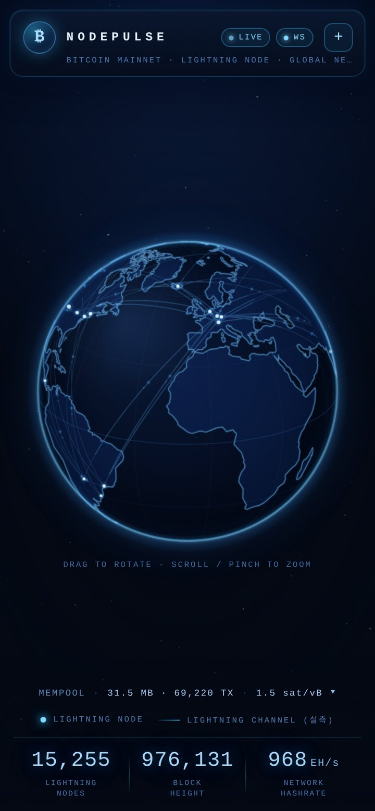

<div align="center">


# NodePulse

**Bitcoin L1 mainnet full-node map and real-time network monitor, with the Lightning channel graph one tap away.**


</div>

NodePulse watches Bitcoin **L1 mainnet** first: the reachable full-node network as the
Bitnodes crawler sees it — node count, clear-net/Tor/I2P split, country and continent spread,
client versions — plus the chain tip, mempool pressure, fee market and the next-block fee
projection. The Lightning channel graph is still there as a second layer, one tap away.

It runs with **zero dependencies**: no framework, no bundler, no package manager, no CDN, no
external image or font request; the entire application is a single self-contained document
that draws every frame with the Canvas 2D API.

## Two layers

| Layer | What the globe shows | Primary data |
| --- | --- | --- |
| **Bitcoin L1** (default) | every unique coordinate the Bitnodes crawler geolocated, one dot per 3° cell | `bitnodes.io/api/v1/snapshots/latest/?field=coordinates` |
| **Lightning** | up to 22 nodes sampled from the real channel graph, one arc per open channel between drawn dots | `mempool.space/api/v1/lightning/channels-geo` |

The switcher sits under the title (`BITCOIN L1 | LIGHTNING`); the `EN / KO` button next to it
switches language, and both choices are remembered.

Each layer carries its own palette, so the globe you are looking at is readable at a glance:
**Bitcoin L1** keeps the original cyan / deep-blue identity (`#38bdf8` on `#040914`), and
**Lightning** has a distinct electric violet one. Neither layer borrows the other's signal
colour.

The L1 layer draws **no links at all**. Bitnodes publishes no per-node peer graph, so the only
honest options are to draw nothing or to invent a mesh — it draws nothing. Tor and I2P nodes
(15,577 of 21,826 in the bundled snapshot) carry no coordinates, so they are counted in the
totals and the transport split but not placed on the globe.

<div align="center">


</div>

<div align="center">

</div>

---

## Core design principle — zero simulated data

Every number and every line on the globe is a value the network actually reported. Nothing
is generated, interpolated from a model, or placed for visual balance.

| Element on screen | Source | Transport |
| --- | --- | --- |
| Block height, latest blocks, block interval | `mempool.space/api/blocks/tip/height`, `/api/v1/blocks` | REST |
| Hashrate, difficulty adjustment | `/api/v1/mining/hashrate/1w`, `/api/v1/difficulty-adjustment` | REST |
| Mempool size, transaction count, fee histogram | `/api/mempool`, `/api/mempool/recent`, `/api/v1/fees/recommended` | REST |
| Lightning node count, channel count, total capacity | `/api/v1/lightning/statistics/latest` | REST |
| Node distribution by country | `/api/v1/lightning/nodes/countries` | REST |
| Globe node positions, aliases, capacities, degrees | `/api/v1/lightning/channels-geo`, `/api/v1/lightning/nodes/{pubkey}`, `nodes/rankings/{connectivity,liquidity}` | REST |
| Inter-node arcs | `channels-geo` — one arc per **real open channel** | REST |
| L1 reachable node count, crawler height | `bitnodes.io/api/v1/snapshots/latest/?field=coordinates` | REST (native bridge on Android) |
| L1 unique node coordinates (the globe dots) | same `?field=coordinates` payload | REST (native bridge on Android) |
| L1 clear-net / Tor / I2P split | `?field=top` → `top_asns` (`TOR`, `I2P`, `AS…`) | REST (native bridge on Android) |
| L1 client versions (`/Satoshi:x.y.z/`) | `?field=top` → `top_user_agents` | REST (native bridge on Android) |
| L1 countries / continents | `bitnodes.io/api/v1/nodes/` (all pages) folded into the bundled snapshot by `fetch_l1.py` | build time |
| Next-block fee projection | `mempool-blocks` stream | WebSocket |
| Mining pool share of the last week | `/api/v1/mining/pools/1w` | REST |
| Live block / mempool / fee pushes | `wss://mempool.space/api/v1/ws`, with `mempool.emzy.de` and `mempool.ninja` as mirror fallbacks | WebSocket |
| Watchdog alerts | derived from the values above: last block age, fee spike, pool share, a hash change at a seen height | local |

* **The arcs are channels, not decoration.** A line is drawn only when both endpoints are
  among the nodes on screen *and* the pair exists as an open channel in `channels-geo`.
  There is no proximity heuristic, no nearest-neighbour fallback, no synthetic mesh.
* **Node selection is topology-driven.** Up to 22 nodes are sampled from the real channel
  graph, not from a ranking list, so every dot is a node that actually holds channels that
  can be drawn (`fetch_channels.py`, `MAX_NODES`).
* **Built-in snapshot, honestly labelled.** A snapshot of the same real payloads is
  embedded at build time (`src/data/seed-nodes.js`, `src/data/channels-data.js`) so the app
  still shows the network's last known geometry with no connection. The UI never passes the
  snapshot off as live: the status pill and the data row report the state, the source, and
  the timestamp of what is being shown.
* **Rate limits are surfaced, not hidden.** Requests rotate across
  `mempool.space`, `mempool.emzy.de`, and `mempool.ninja`, and the WebSocket rotates through
  the same three mirrors; when all of them fail the app degrades to the snapshot and says so
  instead of substituting values.
* **A malformed answer is rejected, not drawn.** Every feed shape-checks what it uses — REST
  loaders and WebSocket pushes alike: a finite number where a figure is printed, a list where
  a row list is walked, a hash string where a hash is shortened. A payload that fails keeps
  the previous value on screen, so a broken mirror or a captive portal cannot turn a figure
  into `NaN` or blank the panel, and a failed per-node detail fetch keeps the alias, city and
  country already cached instead of overwriting them with nothing.
* **Country counts say which snapshot they are.** Bitnodes exposes per-node country only
  through a paginated 21,826-row list (~20 MB). The app fetches it at build time
  (`fetch_l1.py`) and stamps that block with the capture date instead of pretending it is
  live; the live number, height, transport split, client versions and globe dots come from
  the two light endpoints above.
* **Nothing the crawler cannot know is invented.** No per-node latency, uptime, disk size or
  per-node height; no guessed P2P connection between L1 nodes.

---

## Architecture and technical highlights

The constraint that shapes the whole codebase is that a phone must hold 60 fps on a
software-rasterised Canvas while the network is still arriving. Each decision below exists
to remove per-frame work.

### 1. 3D orthographic projection with pre-computed ring caches
The globe is an orthographic projection of lon/lat geometry, not a raster or a WebGL
texture. `prepRing()` converts every coastline ring once into unit-sphere vectors; each frame
`projectRing()` applies the camera's pre-computed sin/cos matrix and produces screen-space
points plus a `z` value per point. No trigonometric function is evaluated at draw time, and
the same cache feeds land, graticule, and hit-testing.

### 2. A geometric horizon, and fills that close on the limb
Naive polygon filling of a sphere breaks in two ways: rings that cross the antimeridian
produce chords straight across the disc, and closing a ring along the back of the sphere
inverts the covered area. Here the horizon is solved analytically — the visible hemisphere is
exactly `z = 0` — so a ring is split into visible runs at its own `z = 0` crossings, and
`fillRun()` closes each run along the limb arc between those crossings. `fillRing()` then
batches every run of every continent into **one** path and **one** fill call per frame. The
result is a solid body with no seam, no chord, and no ocean filled at any rotation
(verified pixel-by-pixel by `test/fill-truth.js`, below).

### 3. Real-topology graph pruning that keeps the edge of the network
`channels-geo` returns thousands of channels; drawing them all is noise. The graph is pruned
to `LINK_PER_NODE = 5` arcs per node by processing nodes in ascending real degree, so a
small regional node keeps its one or two channels instead of being crowded out by a hub.
Out of 5 812 usable channels in the current snapshot, the globe draws about 44 arcs between
20 plotted nodes: a single connected component that still keeps low-degree regional nodes
visible, at under 1 % of the raw edge count.

### 4. A 60 fps mobile budget
* **No `shadowBlur`, ever.** Every glow is a pre-rendered radial-gradient sprite blitted
  with `drawImage`; `shadowBlur` alone costs more than the whole rest of the frame on a
  mid-range Android GPU.
* **Baked offscreen layers.** Starfield, globe body, atmosphere rim and land glow are
  rendered once per resize into offscreen canvases; a frame only blits them.
* **Depth-banded strokes.** Channel arcs are projected once, then stroked in 2–3 batched
  depth bands whose alpha follows `smoothstep(z)`, so near arcs read as bright and far arcs
  fade toward the limb — a handful of stroke calls for the entire network.
* **Continuous packet interpolation.** `eachPacket()` places each moving light packet by
  interpolating along its arc with the real timestamp, so motion stays correct even when a
  frame is late; packets are not stepped per frame.
* **Adaptive resolution.** Device pixel ratio is capped at 2, and an adaptive tier drops the
  backing store to 0.75, 0.62, then 0.50 when frames persistently miss vsync, stepping back
  up when they do not.
* **Time-driven animation.** Rotation and pulses are computed from the `requestAnimationFrame`
  timestamp, so the globe's motion is independent of frame loss.
* **Nothing runs behind a hidden page.** The globe's frame loop already stopped on
  `visibilitychange`; every repeating timer now does too — polling, refetching, panel
  repaints and the clock all skip while `document.hidden`, and returning to the page
  repaints the clock, the status and the open panel at once so the resumed screen is never
  a stale one.
* **Batched node drawing.** The two thousand-or-so globe dots are drawn one path and one
  fill/stroke per alpha level instead of per dot, with the limb fade and pulse quantised
  to a few levels; geometry and colours are unchanged and the canvas state changes per
  frame drop from thousands to a few dozen.
* **A slow phone clock never prints a negative age.** Block and cache timestamps come from
  the server, so a device clock a few seconds behind makes `Date.now() - stamp` negative.
  Every elapsed figure is clamped at zero — the block list reads `0초 전` instead of the
  em dash a negative second count used to produce, and the watchdog gap never goes below
  zero.
* **A lost focus drops the gesture.** When the WebView loses focus mid-pinch (the app is
  backgrounded, a call arrives) no `pointerup` follows; `touchcancel`, `blur`, `pagehide`
  and a hidden page now clear the pointers, the pinch base and the unfinished drag, so the
  globe keeps answering taps and never re-scales from a distance it no longer knows.

### 5. Zero-dependency build and an automated verification suite
`build.py` inlines CSS, geometry, snapshots, application code, and the base64 app icon into
one document — about 379 KB — with tokens that fail the build if any substitution is missed,
and it refuses to emit a file that could break out of its own `<script>` block.

| Harness | What it proves | Result |
| --- | --- | --- |
| `test/headless.js` | DOM + rendering contract against stubbed canvas with real recorded payloads: both layers, bridge (single-piece and chunked delivery, a lost chunk), snapshots, mempool-blocks, all four watchdog alerts, mirror fallback, malformed REST and WebSocket payloads, a failed node-detail fetch, a clock running behind the API, a pinch dropped by a lost focus, EN/KO | **280 / 280 assertions pass** |
| `test/fill-truth.js` | Rendered continent fill compared with the land polygons over 50 camera angles, 743 k sampled pixels | ≈ 0.4 % false-positive / 0.26 % false-negative, all on sub-pixel Antarctic coastline edges |
| `test/perf.js` | Frame cadence at a 390×844 phone viewport, DPR clamped to 2, then with 4× CPU throttling | p50 16.7 ms (60 fps), p95 33.4 ms under throttle |
| `test/offline.js` | Boot with every network route aborted: snapshot geometry, status disclosure, no JS errors | pass |

---

## Quick start

**Use it.** Open the built file in any modern desktop or mobile browser:

```
dist/nodepulse.html
```

Add it to the home screen on Android or iOS and it launches full-screen with its own icon —
the icon and PWA metadata are embedded in the HTML, so no server and no asset directory are
involved.

**Build it.** Sources live in `src/`; the build is one stdlib-only Python script:

```bash
python3 build.py          # -> dist/nodepulse.html  (and the workspace copy)
node --check src/app.js   # syntax gate
```

**Test it.**

```bash
node test/headless.js               # 280 assertions, no browser required
python3 build.py && node test/fill-truth.js   # browser harness, needs Playwright
node test/perf.js                   # frame-time probe
```

The browser harnesses resolve the built file and a Playwright installation through
`test/env.js`; set `PLAYWRIGHT_PKG` (and `CHROME` for a specific binary) if they are not on
the default module path.

**Refresh the snapshot.** The embedded node sample and channel graph are regenerated from
live API data; after refreshing, rebuild:

```bash
python3 fetch_channels.py   # mempool REST + channels-geo + node details -> src/data/*.js, fixtures/
python3 fetch_l1.py         # bitnodes crawler export -> src/data/l1-data.js, fixtures/l1-snapshot.json
python3 build.py
```

---

## Android APK

The same single file ships as a native Android app: a minimal `WebView` shell
(`android/`) that loads `file:///android_asset/index.html`, with JavaScript and DOM storage
enabled, an edge-to-edge `#040914` dark system bar treatment, and the NodePulse icon as
`ic_launcher` / `ic_launcher_round` (legacy mipmaps plus an adaptive icon).

* **Package:** `com.jbitmstr.nodepulse`
* **Min / target SDK:** 24 / 34
* **Version:** 1.1.9 (`versionCode` 11)

**Locked down shell.** File access, content access, file-URL access and universal access
from file URLs are all off; the only page the WebView can show is the bundled asset, a
navigation anywhere else is refused, a TLS error cancels instead of continuing, and mixed
content is explicitly set to `MIXED_CONTENT_NEVER_ALLOW` instead of being left to the platform
default. The
page carries its own Content-Security-Policy (`default-src 'none'`; every inline script and
style block named by its SHA-256 hash, so no `'unsafe-inline'` is needed; `data:` icons, and
only the named https/wss hosts), cleartext HTTP is blocked at the manifest, and the release
build is minified with R8. `build.py` computes the hashes over the exact bytes it writes and
fails the build if the policy it emitted does not name every block it produced.

**Never a blank start.** `onCreate` restores the WebView's saved state only when
`restoreState()` answers with a back/forward list; when the bundle came from a killed
process, another WebView version or holds nothing usable, the method now loads the bundled
asset instead of leaving the WebView on an empty page (the old code loaded the app only when
the bundle was `null`).

**Native HTTP bridge.** `bitnodes.io` answers without an `Access-Control-Allow-Origin`
header, so a WebView `fetch` would be blocked by CORS — and the L1 layer is the primary
dataset. `MainActivity.HttpBridge` exposes `NPBridge.fetch(id, url)`, performs the GET on a
bounded `ThreadPoolExecutor` (two workers, one spare, 32 queued requests — the boot burst
is about eleven concurrent GETs — idle threads retired after 30 s; anything beyond that is
refused at once so the page falls to the next mirror or snapshot) with `HttpURLConnection`,
gzip, 12 s connect / 25 s read and a 3 M-character
body cap, then calls `window.NPBridgeOnData(id, ok, body)` with the body unchanged. The
call string is built on the fetching thread, so the UI thread only
hands the finished string to the WebView. Hosts are whitelisted
(`bitnodes.io`, `btcnodes.io`, `mempool.space`, `mempool.emzy.de`, `mempool.ninja`), a URL
carrying `user:password@` is rejected, and
redirects are followed by hand so every hop is checked against that same list, so the
interface cannot be used as an open proxy. The `mempool.space` mirrors answer
`Access-Control-Allow-Origin: *`, so their JSON is fetched normally; when CORS still refuses
one, the page retries it through the bridge. When the bridge is absent — the plain web build
— the page tries `fetch` and falls back to the bundled snapshots, labelled by date.

**Bounded delivery.** A large answer is never built into one `evaluateJavascript()` call:
that needed the body, its quoted copy — one character can grow to six as `\uXXXX` — and the
finished call on the heap at once, per thread, up to three threads at a time. The bridge
hands a body over in 32 K-character chunks instead, one call per chunk carrying
`(id, ok, part, fin, seq)`, so each call string stays about 0.4 MB even in the worst
quoting case and three concurrent deliveries stay within a couple of megabytes whatever the
body size. The page buffers the parts and joins them in sequence order when the final call
arrives; a sequence with a hole fails that request and falls to the next mirror or snapshot
rather than splicing a body it never saw. A body above the 3 M-character cap is one failure
call, never a copy.

**Build it automatically.** `.github/workflows/build-apk.yml` runs on every push to `main`
and on demand:

1. `python3 build.py` builds the single-file app.
2. `node test/headless.js` runs the offline verification harness.
3. The built HTML is copied to `android/app/src/main/assets/index.html`.
4. `gradle :app:lintDebug :app:testDebugUnitTest` checks the shell.
5. A push to `main` assembles the debug APK. A `v*` tag assembles **only** the signed,
   minified release APK and fails before building when the signing secrets are not set, so a
   tag never publishes a debug-key build.
6. On a tag the signed APK is uploaded as the workflow artifact **`nodepulse-apk`** (file
   `nodepulse.apk`); on a branch push the debug one is **`nodepulse-apk-debug`**.

Every third-party action in the workflow is pinned to the commit its release tag pointed at
(`actions/checkout@11d5960a…`, `actions/setup-java@cf277c60…`, `actions/setup-node@49933ea5…`,
`gradle/actions/setup-gradle@ed408507…`, `actions/upload-artifact@ea165f8d…`,
`softprops/action-gh-release@3bb12739…`), with the tag in a trailing comment: a tag can be
moved to new code, a commit SHA cannot.

Staging is also wired into the Gradle graph itself: `stageWebApp` is a dependency of
`preBuild`, so a plain local `gradle assembleDebug` stages `dist/nodepulse.html` into the
assets and can no longer package an APK without `assets/index.html` (which would boot to a
blank screen) even when `build.py` has not been run in that checkout first.

**Get the APK.**

* GitHub → **Actions** → *Build Android APK* → latest run → **Artifacts** →
  `nodepulse-apk`, or
* from a shell: `gh run download --name nodepulse-apk -R CoreJBH/nodepulse`

Install it on the phone (allow "install unknown apps" for the browser or file manager you
open it with). A tag push (`v*`) attaches the signed release APK — and nothing else — to that
release.

**Release signing fails closed.** A release APK is signed with the owner's long-lived key,
read from `NODEPULSE_KEYSTORE_BASE64` / `NODEPULSE_KEYSTORE_PASSWORD` / `NODEPULSE_KEY_ALIAS`
/ `NODEPULSE_KEY_PASSWORD` (repository secrets, decoded to a file for the build) or, locally,
from `android/keystore.properties` (git-ignored). When any of them is missing there is no
fallback: `assembleRelease` / `bundleRelease` stop before an APK exists and name what is
missing, because an APK signed with the debug key installs but can never update a released
one, and nothing about it says which key signed it. `assembleDebug`, `lintDebug` and the
unit tests never touch the key. A `v*` tag needs the secrets — that workflow run fails
rather than publishing a differently signed APK; a branch push builds only the debug APK.

**Build locally.** With JDK 17 and the Android SDK installed:

```bash
cd android
gradle assembleDebug     # -> app/build/outputs/apk/debug/app-debug.apk (no key needed)
gradle assembleRelease   # -> needs the four NODEPULSE_* signing values, or it stops
```

---

## Repository layout

```
src/
  index.template.html      document shell: head, metadata, inline icon slots, both layers
  app.css                  layout, panels, typography
  app.js                   projection, fill, graph, packets, data layer, UI (~2 000 lines)
  data/                    world geometry, country table, real node + channel + L1 snapshots
assets/                    app icon (64/180/192/512), README screenshots
build.py                   single-file assembly (inlines CSS/JS/data/base64 icon)
dist/nodepulse.html        build output, ready to open
fixtures/                  recorded API payloads the headless test replays
fetch_l1.py                Bitnodes crawler export -> src/data/l1-data.js (L1 snapshot)
test/                      headless contract, fill truth, perf, offline, screenshot harnesses
fetch_channels.py          snapshot capture from the live API into src/data/ + fixtures/
fetch_nodes.py             node-detail capture helper
make_launcher_icons.py     regenerates the Android launcher icons from assets/icon-512.png
make_icons.py              regenerates the web icon set from assets/icon-master.png
android/                   WebView wrapper: Gradle project, manifest, launcher icons
.github/workflows/         build-apk.yml — build + package the APK on CI
```

---

## Data sources and attribution

Bitcoin mainnet values come from [mempool.space](https://mempool.space) (REST + WebSocket),
with `mempool.emzy.de` and `mempool.ninja` as fallbacks. L1 full-node values come from
[Bitnodes](https://bitnodes.io) (`/api/v1/snapshots/latest/`), the independent crawler of the
Bitcoin P2P network. NodePulse is an independent visualiser and is not affiliated with or
endorsed by either project. Public API endpoints are rate limited; the app is designed to
disclose throttling and outages rather than to hide them.

---

## Contributors

* **[@JBITmstr](https://github.com/JBITmstr)** — Creator, product direction & design
* **Gilbert ([Pickle](https://pickle.com))** — AI co-builder (implementation, 3D globe rendering & CI)

